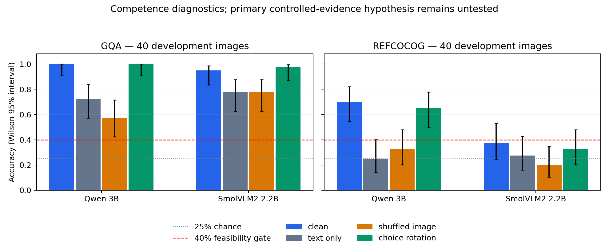

# E1: two-model competence gate FAILED

The prescribed 40 unique development images/task were scored by both frozen models. No item was selected or dropped based on its prediction. The 80 development images are disjoint from the 24 debug images. Four conditions per item/model produced 640 score rows. Reference choices were frozen; option rotation changes the gold letter consistently while preserving the semantic answer. No-image prompts omit the image content item using the official chat template. Shuffled controls use the next image cyclically within task, resized to original dimensions, retaining the original candidate overlays.

| Task | Model | Clean | Text only | Shuffled image | Choice rotation | Clean Wilson 95% CI | Gate |
|---|---|---:|---:|---:|---:|---|---|
| gqa | qwen | 40/40 (100.0%) | 29/40 (72.5%) | 23/40 (57.5%) | 40/40 (100.0%) | 91.2%–100.0% | PASS |
| gqa | smol | 38/40 (95.0%) | 31/40 (77.5%) | 31/40 (77.5%) | 39/40 (97.5%) | 83.5%–98.6% | PASS |
| refcocog | qwen | 28/40 (70.0%) | 10/40 (25.0%) | 13/40 (32.5%) | 26/40 (65.0%) | 54.6%–81.9% | PASS |
| refcocog | smol | 15/40 (37.5%) | 11/40 (27.5%) | 8/40 (20.0%) | 13/40 (32.5%) | 24.2%–53.0% | FAIL |

The predeclared threshold is clean accuracy >=40% plus positive image-over-text accuracy gain for every model/task. SmolVLM2 RefCOCOg is 15/40 = 37.5%; it fails that deterministic engineering screen. Its Wilson interval crosses 40%, so this is not proof that population accuracy is below 40% or that the model fundamentally cannot ground expressions. The current configuration does not qualify for the prescribed full matrix.

The macro image-versus-text accuracy contrast is +25.00%, with 95% paired cluster-bootstrap interval [+16.25%, +33.75%], 2,000 replicates, seed 20264. Images are resampled once within task and carried across both models. This is **not H2's controlled-estimator-versus-baseline effect**. Per-cell paired intervals, NLL, Brier scores, entropy, ten-bin descriptive ECE, subtype counts, permutation disagreement and timing are in `evidence/executed_summary.json`. Accuracy intervals in the figure/table are Wilson intervals, not bootstrap intervals.

Failure diagnosis: SmolVLM2 predicts B on 20/40 clean grounding items and 32/40 shuffled grounding items. Choice rotation reduces grounding accuracy to 13/40. Both GQA models have strong text-only performance (72.5% and 77.5%); the automatically constructed four-choice subset may be easy or prior-driven. These results do not validate full GQA or free-form VQA competence. GQA development sampling used one explicit referenced object and a same-global-answer-group distractor pool; broad relation/spatial strata and exhaustive distractor ambiguity audits were not completed. Candidate box overlap/texture eligibility for later region interventions is also unfinished. No post-outcome exclusion or replacement was made.

The independent-family fallback checked was `google/paligemma2-3b-mix-448`, revision `1406c92ec87d32cc6b983239278901b904ba7a51`. The official API reports manual gating and its config returns HTTP 401. It was not loaded or fit-tested; no assertion that all possible other backbones are unavailable is made. See `evidence/fallback_access.json`.

