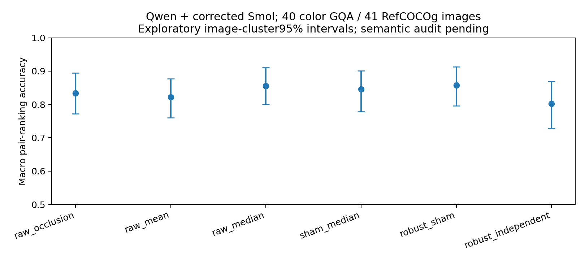
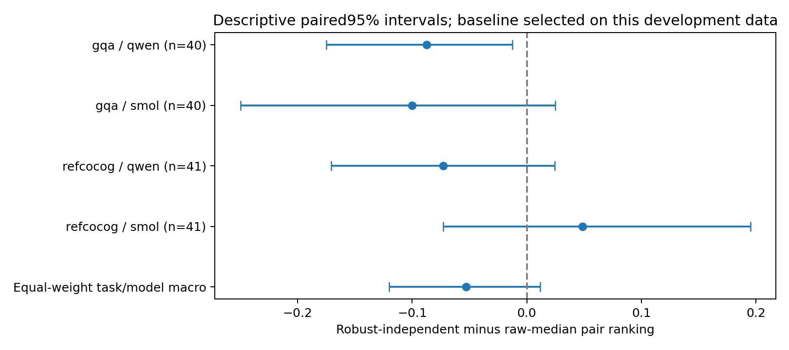
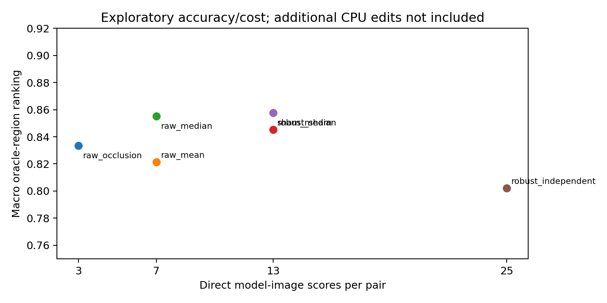

# E3 exploratory comparison — completed development replication

**S3 has not demonstrated added value.** On the intended Qwen + corrected-Smol pair, S3 ranks 80.23% versus 85.53% for the development-selected raw-median baseline: **-5.30 percentage points**, descriptive paired95% CI **[-12.02, +1.14] pp**. Direct cost is25 versus7 model-image scores/pair. Overall scientific verdict: **INCONCLUSIVE**; do not launch confirmation of this formulation.

The initial15 GQA/16 RefCOCOg pilot and independent fixed25/task extension are preserved separately. Pooled40 color GQA/41 RefCOCOg images are shared across all3 backbones (81 independent image clusters, not243 independent model observations). Gold and fixed-original-prediction anchors are separate. No outcome-dependent image filtering. The extension was declared after initial results, with fixed formulas/operators/eligibility; it is further development, never confirmation.

| Method | Macro pair ranking (image-cluster95% CI) | Direct scores/pair |
|---|---|---:|
| raw_mean | 82.15% [76.05%, 87.73%] | 7 |
| raw_median | 85.53% [79.99%, 91.06%] | 7 |
| raw_occlusion | 83.35% [77.20%, 89.45%] | 3 |
| robust_independent | 80.23% [72.85%, 87.00%] | 25 |
| robust_sham | 85.76% [79.57%, 91.34%] | 13 |
| sham_median | 84.54% [77.80%, 90.12%] | 13 |

| Task | Model | n | Raw occlusion | Raw median | Sham median (S1) | Robust sham (S2) | Independent robust (S3) |
|---|---|---:|---:|---:|---:|---:|---:|
| gqa | qwen | 40 | 80.00% | 83.75% | 77.50% | 77.50% | 75.00% |
| gqa | smol | 40 | 90.00% | 92.50% | 87.50% | 87.50% | 82.50% |
| gqa | internvl | 40 | 80.00% | 82.50% | 82.50% | 80.00% | 85.00% |
| refcocog | qwen | 41 | 85.37% | 87.80% | 85.37% | 87.80% | 80.49% |
| refcocog | smol | 41 | 78.05% | 78.05% | 87.80% | 90.24% | 82.93% |
| refcocog | internvl | 41 | 87.80% | 87.80% | 87.80% | 87.80% | 87.80% |

Raw median is the single **DEVELOPMENT_SELECTED_NOT_LOCKED** comparator proposal. Selection maximizes equal-weight task/model gold-anchor ranking among the declared baselines, then minimizes direct calls and uses lexical tie break. S2 is competitive in aggregate but does not establish a meaningful gain: raw median85.53%, S2 85.76%, S3 80.23%. Candidate-specific control subtraction is harmful relative to S2 on these data: paired effect−5.53pp, descriptive95% CI[−10.44,−1.22]. This is not a reason to tune S3 post hoc.

Pair ranking gives half credit to ties. Within-pair AUROC equals this concordance; pooled-region AUROC is separately reported. Bootstrap resamples image IDs once per task, carrying both primary models jointly;5,000 replicates, seed20269. Cell summaries use2,000 replicates with the same image-pair alignment. Supplementary Wilson bounds are provided for tie-free cells; small-sample empirical intervals can be degenerate. No multiplicity-adjusted confirmatory inference is made.

Full tables, frozen-prediction anchors, per-cell intervals, negative-score exceedances, ablations and initial/extension estimates: [replication tables](evidence/v2/E3_replication_tables.md), [complete analysis](evidence/v2/E3_replication.json). Earlier Qwen/InternVL-only results remain in `E3_comparison.json`; corrected initial Qwen/Smol results are `E3_corrected_initial.json`.

Confidence and entropy are image-level selectors, not region-ranking baselines; a shared clean confidence cannot distinguish two regions. Clean calibration and oracle-region selection are in `clean_calibration_and_oracle_selectivity.json`. S3's predicted-answer, oracle-region AURC versus confidence differs+0.0183[−0.0241,+0.0620], where positive is worse. This does not improve deployment reliability. The separate fixed-grid no-oracle evidence diagnostic remains limited to Qwen/InternVL, eight images/task/model; S3 loses to confidence in3/4 cells at49 versus1 scores/image. Smol grid inference was cancelled to preserve the cumulative cap and prioritize correcting its adapter.

S1=median sham-corrected effects; S2=S1−0.5 scaledMAD; S3 applies independent candidate-control subtraction before median/MAD. Gold anchors are oracle-answer diagnostics. Predicted anchors freeze the original unedited answer and never follow edited argmax; annotated candidate pairs remain oracle-region diagnostics. Negative>1-logit exceedances are not validated causal false-positive rates.

These are annotation-reference region rankings, not verified causal relevance. Source annotations can be incomplete: GQA1593212 asks locomotive color but its official box[875,671,977,761] covers the lower coupler in a1024×768 image, leaving most of the train visible. Agent visual inspection is not an independent human judgment. This case and all other failures remain included. Confidence intervals do not repair this label problem, semantic edit errors, cross-dataset identities missing from available mappings, or adaptive development reuse.

The baseline was chosen on the same pooled development results. Its paired bootstrap interval is descriptive and does not account for comparator selection. No confirmatory p-value, positive effect claim, equivalence claim or statistically validated deployment reliability is asserted. Three operators are correlated, and their scaled MAD is a disagreement penalty, not a standard error. The original practical development target is+3pp; current S3 has not supported it. No coefficient or threshold was changed to rescue the outcome.

Source audit: `BASELINE_SOURCE_AUDIT_V2.md`. EVICT equations2–3 were tested as a gray128, semantic-option-text, fixed-choice adapter; no full official reproduction is claimed. CSGR/CoEV full systems remain unavailable/incompatible in the audited scope. Official LaMa and all3 model checkpoints were actually executed at pinned revisions.
