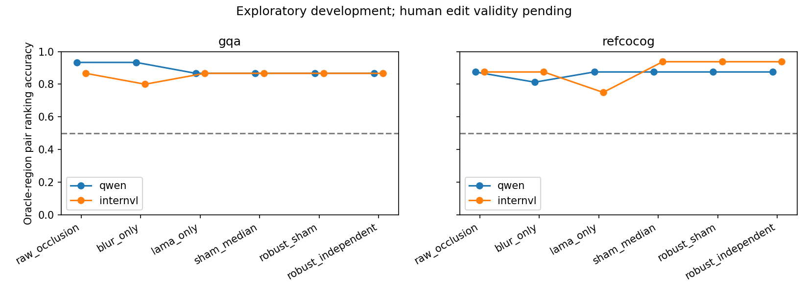

# E3 exploratory comparison — initial paired pilot

**The repaired complex estimator has not demonstrated added value.** On 15 harder color GQA and 16 RefCOCOg development image pairs, shared by Qwen and InternVL, robust-independent minus raw multi-operator mean is **0.000**, paired image-cluster bootstrap 95% CI **[-0.050,+0.050]**. Versus raw occlusion: -0.0010 [-0.0854,+0.0656]. Versus sham-median: exactly zero on every oracle pair. These are development diagnostics with unvalidated semantic edits; they do not establish equivalence or a confirmatory null result.

| Task | Model | n | Raw occlusion | Sham median | Robust sham | Robust independent |
|---|---|---:|---:|---:|---:|---:|
| Hard color GQA | Qwen | 15 | .933 | .867 | .867 | .867 |
| Hard color GQA | InternVL | 15 | .867 | .867 | .867 | .867 |
| RefCOCOg | Qwen | 16 | .875 | .875 | .875 | .875 |
| RefCOCOg | InternVL | 16 | .875 | .938 | .938 | .938 |

Numbers are gold-answer, annotated-region pair-ranking accuracies, with ties half-credit. Complete per-cell intervals, pooled region AUROC, negative-region score exceedances, frozen-prediction anchors and all baselines are in [the generated table](evidence/v2/E3_tables.md) and [machine-readable analysis](evidence/v2/E3_comparison.json). The within-pair AUROC equals pair-ranking accuracy; pooled AUROC compares scores across all positive/negative regions and is separately named. It uses image-cluster confidence intervals. Shared image indices are preserved across models; the joint estimand weights tasks/models equally. Fixed seed 20269; 5,000 replicates for paired joint contrasts, 2,000 for cell summaries. Intervals are descriptive and unadjusted across many comparisons.

Per-method direct model-image costs per region pair: individual operator 3 (clean+two removals); raw three-operator mean/median 7; three-operator sham estimates 13; candidate-specific independent correction 25. All analyses reuse a common 25-image factorial, so their incremental analysis forwards are zero. Additional control inference doubles the 12 edited images to 24. Anchor choice adds no inference. Compute and semantic validation costs must accompany comparisons; matched-cost operator subsets and real ablations are being analyzed separately.

Raw sensitivity is bounded choice-logit difference. Sham sensitivity is clean minus sham. The reported negative >1 log-odds rate is a computational exceedance diagnostic, **not an established causal false-positive rate**: annotated negatives may still provide useful context, and inpainting can invent content. Reduced negative scores can also mean indiscriminate signal shrinkage. Human removal/sham/control validity remains **HUMAN_AUDIT_PENDING**.

The frozen-prediction analysis keeps the original argmax fixed across every edit. These annotated-region pairs remain oracle-region diagnostics even when the answer anchor is predicted. A separate geometry-only grid run is being prepared for a genuinely annotation-free candidate diagnostic. No result here supports deployment reliability or authorizes E5.

Closest-paper baseline source audit and a fixed-choice CED adapter are in progress. No simplified estimator is called an official reproduction. The coefficient stays 0.5; it will not be tuned to make this result positive.
